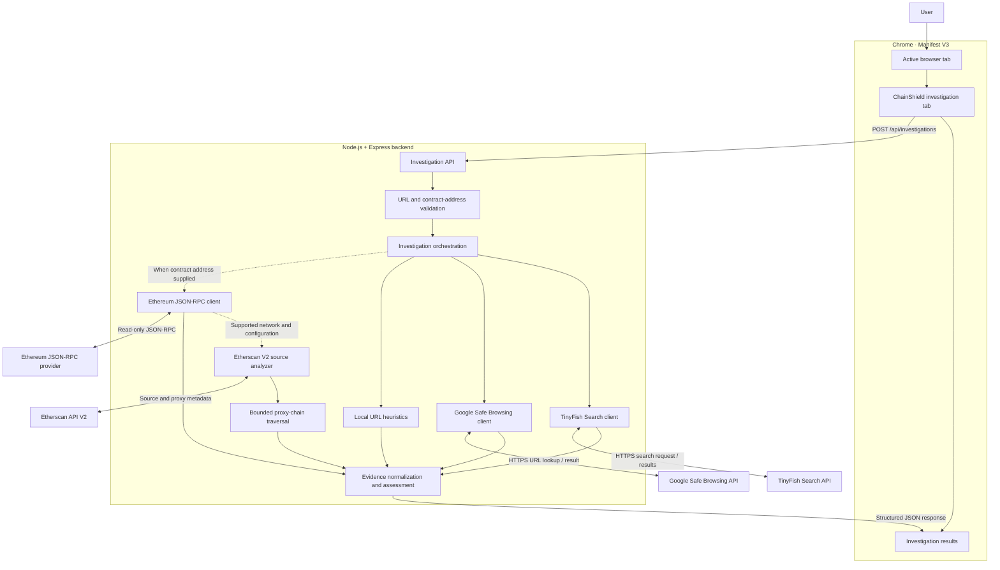
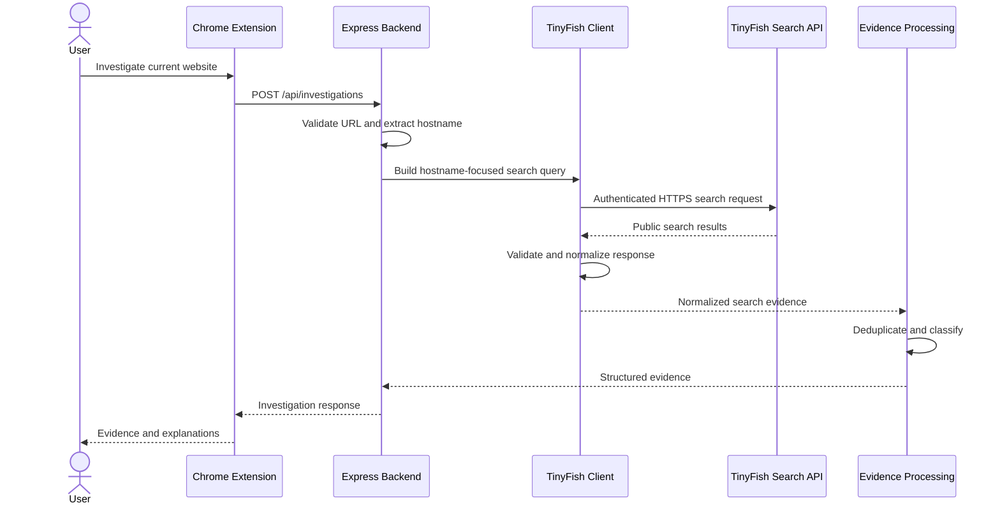
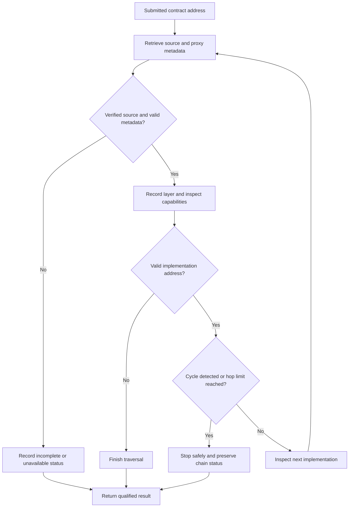

# 🛡️ ChainShield

<p align="center">
  <strong>Investigate the website. Inspect the evidence. Understand the contract.</strong>
</p>

<p align="center">
  An evidence-driven Chrome security extension that combines web threat intelligence, URL analysis, and on-chain smart-contract inspection in one investigation workflow.
</p>

<p align="center">
  
  
  
  
  
</p>

<p align="center">
  <a href="#-how-chainshield-works">Architecture</a> ·
  <a href="#-tinyfish-integration">TinyFish Integration</a> ·
  <a href="#-web3-and-smart-contract-analysis">Web3 Analysis</a> ·
  <a href="#-quick-start">Quick Start</a> ·
  <a href="#-security-model-and-limitations">Security Model</a>
</p>

---

## The problem

A website can look legitimate while its domain, reputation, or associated smart contracts deserve closer inspection. Traditional browsing separates these signals across search engines, threat-intelligence services, blockchain explorers, and RPC providers.

ChainShield brings these independent sources into a single, user-initiated investigation.

**ChainShield is designed around one principle: security decisions should be supported by evidence, not confident-looking guesses.**

It combines:

- **Web intelligence:** TinyFish Search retrieves publicly available search evidence relevant to the investigated hostname.
- **Threat reputation:** Google Safe Browsing checks the submitted URL against its threat intelligence.
- **URL structure analysis:** Local heuristics identify selected suspicious hostname patterns.
- **Blockchain inspection:** Ethereum JSON-RPC retrieves network metadata, the latest block number, and contract bytecode presence.
- **Verified-source analysis:** Etherscan API V2 provides verified contract source metadata and supports bounded proxy-chain inspection on Ethereum Mainnet.

Each layer has a separate responsibility. A search result is not a threat verdict, bytecode presence is not a security guarantee, and verified source code is not proof that a contract is safe.

## ✨ Core capabilities

| Capability | What ChainShield does | What it does not claim |
|---|---|---|
| TinyFish Search | Retrieves public search results relevant to a hostname and security-focused query | Does not independently prove a website is malicious |
| Google Safe Browsing | Checks the submitted URL for reported threats | A no-match response does not prove safety |
| URL heuristics | Detects selected patterns such as IP-address hostnames, punycode labels, and unusually deep subdomains | Does not establish malicious intent |
| Ethereum JSON-RPC | Reads chain ID, latest block number, and bytecode at a supplied address | Does not determine whether an address is malicious |
| Etherscan source analysis | Retrieves verified-source information and examines selected capability indicators | Does not perform a complete formal audit |
| Proxy-chain traversal | Follows validated implementation metadata with a bounded traversal depth and cycle detection | Does not resolve every possible proxy architecture |
| Failure isolation | Keeps independent assessment results available when another provider fails | Does not turn a failed check into a clean result |

---

## 🧭 How ChainShield works

A normal website investigation and a smart-contract investigation are related, but distinct.

### Website investigation

1. The user opens a website in Chrome and explicitly starts an investigation.
2. The extension obtains the active tab's URL and sends it to the local Express backend.
3. The backend validates the submitted URL before passing it to the relevant analysis modules.
4. TinyFish Search, Google Safe Browsing, and local URL heuristics perform their respective checks.
5. The backend normalizes and separates their results rather than treating all signals as interchangeable.
6. The ChainShield investigation tab presents the returned evidence and assessment details for the user to review.

### Smart-contract investigation

1. The user optionally supplies an Ethereum contract address.
2. The backend validates its format before making contract-related provider calls.
3. Ethereum JSON-RPC retrieves the chain ID, latest block number, and bytecode at the requested address.
4. When supported by the reported network and configured Etherscan credentials, the source analyzer retrieves verified-source metadata.
5. Proxy metadata is followed through a bounded implementation chain, with address validation and cycle detection.
6. Selected source patterns are reported as capability indicators with analysis status and evidence.
7. Incomplete, unsupported, and unavailable results remain distinguishable from completed analysis.

The contract address is an explicit input. Providing an address does not establish that the investigated website owns or uses that contract.

## 🏗️ System architecture



### Architectural decisions

- **Independent signal sources:** Search relevance, threat-reputation results, URL heuristics, RPC observations, and source-analysis indicators remain conceptually separate.
- **Optional Web3 analysis:** A website-only investigation does not require a contract address.
- **Provider failure isolation:** An upstream failure should not erase valid findings from unrelated checks.
- **Bounded external calls:** Provider requests use validation, timeouts or response-size limits where implemented, and controlled error handling.
- **Evidence-first reporting:** Unavailable or incomplete analysis is not silently converted into a clean security result.
- **Read-only blockchain access:** ChainShield does not connect to a user's wallet, sign transactions, or submit transactions.

---

## 🔎 TinyFish integration

TinyFish is a core part of ChainShield's web-intelligence layer. It allows the backend to retrieve publicly available search evidence related to the website being investigated.

Instead of treating the presence of a domain in a search result as proof of malicious activity, ChainShield uses the results as **investigative evidence that needs context**.

### Integration workflow



### What TinyFish contributes

| Stage | Responsibility |
|---|---|
| Query construction | Uses the investigated hostname with security-focused search terms |
| Search execution | Calls the configured TinyFish Search API from the backend |
| Response handling | Validates and normalizes the provider response |
| Evidence processing | Deduplicates results and assigns relevance categories |
| Presentation | Returns structured results for display in the extension |

### Evidence classification

ChainShield separates returned search results into three categories:

| Category | Meaning |
|---|---|
| `domain_specific` | The result URL or relevant text is associated with the investigated hostname |
| `general_information` | The result provides broader security information without clear domain-specific evidence |
| `irrelevant_or_unclear` | The relationship to the investigated hostname is weak, unclear, or unrelated |

These are **relevance categories, not threat verdicts**.

A domain-specific result may be inaccurate, harmless, outdated, or misleading. Conversely, a fraudulent website may have little or no searchable public history.

### Why the integration matters

TinyFish provides a way to gather public web evidence as part of an investigation instead of relying exclusively on hard-coded hostname patterns.

ChainShield combines that evidence with independent reputation and structural checks, giving the user a broader context for manual investigation.

**Scope clarification:** ChainShield currently uses TinyFish Search for this workflow. The implementation should not be confused with a fully autonomous browser agent, continuous website monitoring, or a general-purpose crawler.

---

## ⛓️ Web3 and smart-contract analysis

ChainShield extends its investigation beyond the website itself when a user supplies an Ethereum contract address.

This layer is deliberately read-only and separates basic on-chain observations from source-code capability analysis.

### 1. Ethereum JSON-RPC

The backend uses the configured `ETH_RPC_URL` endpoint to perform three read-only JSON-RPC calls:

| RPC method | Purpose |
|---|---|
| `eth_chainId` | Identifies the connected blockchain network |
| `eth_blockNumber` | Retrieves the latest block number reported by the provider |
| `eth_getCode` | Checks whether bytecode is returned for the supplied address at the requested block reference |

The bytecode observation is classified as `no_bytecode` or `bytecode_present`.

Neither outcome establishes whether an address is malicious. An address with no bytecode may be an externally owned account, an undeployed address, or another address without code at that block. A contract with bytecode can still contain dangerous behavior.

### 2. Verified-source analysis through Etherscan

When the network and configuration support the lookup, ChainShield uses Etherscan API V2 to retrieve verified-source information.

The analyzer looks for selected source-code indicators associated with capabilities such as:

- Privileged minting
- Pausing functionality
- Blacklist or denylist functionality
- Upgradeability
- Privileged administration

These indicators are heuristic. Finding a function or pattern does not, by itself, establish that the capability is exploitable, malicious, or improperly controlled.

### 3. Bounded proxy-chain traversal

Proxy contracts can delegate behavior to separate implementation contracts. Inspecting only the initial address may therefore provide an incomplete picture.

ChainShield follows validated implementation metadata returned by Etherscan, with a maximum of three implementation hops after the submitted contract.



The traversal includes cycle detection, address validation, and explicit incomplete states when a layer cannot be fully inspected. The depth limit bounds the investigation; it does not guarantee that every proxy architecture or dependency has been discovered.

### 4. Independent assessment status

ChainShield distinguishes states such as:

| Status | Interpretation |
|---|---|
| `not_requested` | No contract address was supplied |
| `available` | The relevant assessment completed with usable data |
| `incomplete` | Some analysis was possible, but one or more layers or checks remain unresolved |
| `unavailable` | The required provider or lookup could not supply usable results |
| `unsupported_chain` | The source-analysis path does not support the reported network |

The exact status depends on the assessment layer. A completed RPC check does not imply that Etherscan source analysis also completed.

### Important distinction

ChainShield is not a formal smart-contract auditor. It does not currently claim comprehensive vulnerability detection, transaction simulation, wallet protection at signing time, or an automatic determination that a contract is safe.

---

## 🧰 Technology stack

| Layer | Technology | Role |
|---|---|---|
| Browser | Chrome Extension Manifest V3 | User-initiated investigation interface |
| Extension UI | HTML, CSS, JavaScript | Input, progress, evidence, and assessment display |
| Backend | Node.js, Express | Request validation and investigation orchestration |
| Web intelligence | TinyFish Search API | Public search evidence |
| Threat reputation | Google Safe Browsing API | Submitted-URL threat lookup |
| Blockchain access | Ethereum JSON-RPC over HTTPS | Read-only network and bytecode observations |
| Source intelligence | Etherscan API V2 | Verified-source and proxy metadata |
| HTTP and async handling | Node.js built-ins, including `fetch` and `AbortController` | Provider requests, timeouts, and response handling |
| Configuration | dotenv | Backend environment configuration |
| Testing | Node.js test runner | Automated validation of API, integration, and failure-handling behavior |

The current implementation does not require a database or a wallet connection for its core investigation workflow.

---

## 🚀 Quick start

### Prerequisites

- Google Chrome
- Node.js with built-in `fetch` and `AbortController` support (Node.js 18 or newer)
- npm
- A TinyFish API key
- A Google Safe Browsing API key with the required API enabled
- An Ethereum HTTPS JSON-RPC endpoint and Etherscan API key for the optional Web3 analysis

### 1. Clone the repository

```powershell
git clone https://github.com/iamjahnvi/ChainShield.git
cd ChainShield
```

### 2. Install backend dependencies

```powershell
cd server
npm install
```

### 3. Configure environment variables

Create the local environment file using the provided template:

```powershell
Copy-Item .env.example .env
```

Edit `server/.env` and add your own credentials:

```dotenv
PORT=3000

TINYFISH_API_KEY=your_tinyfish_api_key
GOOGLE_SAFE_BROWSING_API_KEY=your_google_safe_browsing_api_key

ETH_RPC_URL=https://your-ethereum-rpc-endpoint
ETHERSCAN_API_KEY=your_etherscan_api_key
```

Use actual provider credentials locally. The values above are placeholders, not working keys.

- `TINYFISH_API_KEY` enables TinyFish Search.
- `GOOGLE_SAFE_BROWSING_API_KEY` enables Google Safe Browsing lookups.
- `ETH_RPC_URL` configures the backend's Ethereum JSON-RPC provider.
- `ETHERSCAN_API_KEY` enables supported verified-source and proxy metadata lookups.
- `PORT` optionally overrides the backend port.

`ETH_RPC_TIMEOUT_MS` can optionally be configured to control the Ethereum RPC timeout where supported by the implementation.

Never commit `server/.env`, place provider keys in extension code, or share credentials in screenshots, logs, or public issues.

### 4. Run the automated tests

From the `server` directory:

```powershell
npm test
```

The latest project audit reported **127 passing tests and zero failures**. Run the suite against your current checkout to verify its present state.

Automated tests use controlled provider responses where applicable; passing tests alone do not prove that live provider credentials or external services are working.

### 5. Start the backend

```powershell
npm start
```

The backend listens on `http://localhost:3000` by default.

Keep the terminal open while testing the extension.

### 6. Check backend health

Open another PowerShell terminal:

```powershell
Invoke-RestMethod http://localhost:3000/api/health
```

A successful health response confirms that the backend is responding. It does not independently confirm that all provider integrations are configured or reachable.

### 7. Load ChainShield into Chrome

1. Open `chrome://extensions`.
2. Enable **Developer mode**.
3. Select **Load unpacked**.
4. Choose the repository's `extension` folder.
5. Click the ChainShield toolbar icon. It opens the app in a dedicated browser tab rather than a small popup.
6. On first launch, complete or skip the four-step introduction to reach the investigation workspace. Later launches open the workspace directly.
7. Start an investigation and review the returned results.

For Web3 testing, enter a valid Ethereum contract address in the optional contract-analysis field.

After editing extension files, return to `chrome://extensions`, reload ChainShield, and click the toolbar icon again. Keep the local backend running while investigating.

---

## 🔌 API reference

### `POST /api/investigations`

Starts an investigation of a submitted website URL. A contract address can optionally request the additional Web3 analysis path.

**Request fields**

| Field | Required | Purpose |
|---|---|---|
| `url` | Yes | Website URL to investigate |
| `contractAddress` | No | Ethereum address for the optional contract analysis |

Example request shape:

```json
{
  "url": "https://example.com",
  "contractAddress": "0xa0b86991c6218b36c1d19d4a2e9eb0ce3606eb48"
}
```

This is an illustrative request shape, not a sample security verdict. The address is supplied explicitly and is not automatically associated with the submitted website.

**Validation expectations**

- Only supported HTTP and HTTPS website URLs should proceed through website investigation.
- A supplied contract address must use the expected `0x` prefix followed by exactly 40 hexadecimal characters.
- Invalid contract addresses should be rejected before contract-provider requests.
- Omitting the contract address should preserve the website-only workflow.

The returned JSON contains the applicable website and provider assessment details. Consult the route implementation for the precise response schema and error format.

### `GET /api/health`

Checks whether the backend is responding.

A successful health check does not guarantee that TinyFish, Google Safe Browsing, Ethereum RPC, or Etherscan is reachable.

---

## 🧪 Testing and verification

ChainShield's automated tests are designed to validate behavior at the boundaries between the extension, backend, and external services.

The latest reported audit covered 127 tests across six test files.

Important test areas include:

- URL and contract-address validation
- API request and response handling
- TinyFish response validation and evidence classification
- Google Safe Browsing match, no-match, and error paths
- Ethereum JSON-RPC response validation and failure handling
- Etherscan source lookup and capability classification
- Proxy-chain traversal, cycles, malformed metadata, and traversal limits
- Incomplete and unavailable analysis states
- Provider failure isolation
- Safe rendering of investigation results

For a release check, run `npm test`, review `git diff --check`, and manually verify both website-only and contract-address investigations with valid provider configuration.

A passing automated suite should be supplemented with live smoke tests because mocked responses cannot establish current provider availability.

---

## 🔐 Security model and limitations

ChainShield is a security-investigation prototype, not a replacement for independent security review.

### Implemented safeguards

- Provider credentials remain on the backend.
- Website URLs and supplied contract addresses are validated before the relevant processing steps.
- Provider calls use controlled request handling, including timeouts, redirect restrictions, and response validation where implemented.
- Ethereum RPC access is read-only and limited to the supported methods described above.
- Contract-source lookups are restricted to the supported chain path.
- Proxy traversal is bounded and uses validated implementation metadata.
- Provider failures and incomplete results are represented explicitly rather than automatically treated as clean findings.
- Extension content is rendered using safe DOM practices rather than trusting arbitrary provider text as HTML.
- Investigations are initiated by the user; ChainShield does not automatically block websites or submit blockchain transactions.

### What ChainShield does not guarantee

- It does not detect every phishing website, scam, or malicious contract.
- It does not prove a website is safe when no threat match or relevant search result is returned.
- It does not treat a verified source as proof of contract safety.
- It does not perform a complete formal verification or comprehensive smart-contract audit.
- It does not establish a relationship between a website and a user-supplied contract address.
- It does not connect to wallets, sign transactions, or automatically block sites.

A production deployment would also require a deployment-specific review of authentication, rate limiting, abuse prevention, origin policy, secret management, monitoring, and operational controls.

---

## 🗺️ Roadmap

Potential next steps, subject to scope and validation:

- Expand threat-intelligence coverage with additional trustworthy public sources.
- Improve evidence provenance, source freshness, and relevance explanations.
- Add repeatable malicious-versus-benign evaluation fixtures to measure detection quality.
- Improve supported proxy and implementation-resolution coverage.
- Add deeper contract analysis only where the method and its limitations can be tested.
- Add caching and abuse controls if the service moves beyond local development.
- Improve extension-level integration testing and release automation.

Future work should preserve the same principle: report what the available evidence supports, make uncertainty visible, and never equate missing evidence with safety.

---

## 🤝 Contributing

Contributions that improve correctness, explainability, test coverage, and safe failure handling are especially welcome.

1. Fork the repository.
2. Create a focused feature branch.
3. Add or update tests for the behavior being changed.
4. Run the test suite and inspect the resulting diff.
5. Open a pull request explaining the problem, implementation, and verification performed.

Do not include API keys, RPC credentials, personal tokens, or local environment files in contributions.

## 📄 License

Check the repository for an existing license before reusing or redistributing the project.

---

<p align="center">
  <strong>ChainShield — Investigate the evidence, not just the claim.</strong>
</p>

<p align="center">
  Built to bring web intelligence and read-only Web3 inspection into one evidence-driven workflow.
</p>


