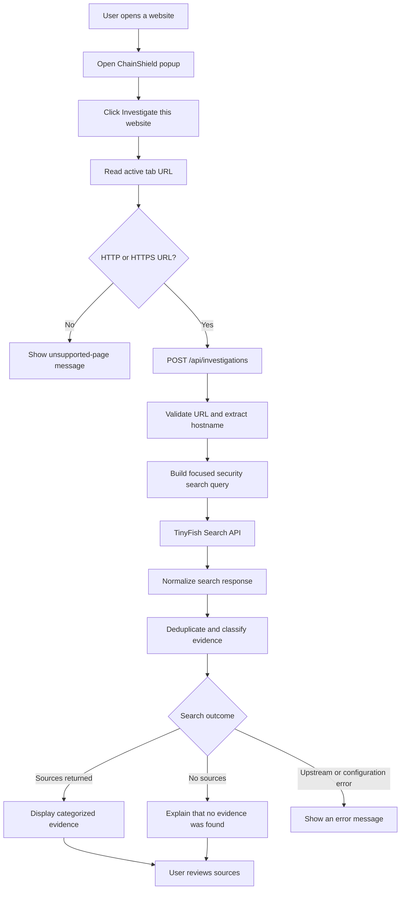
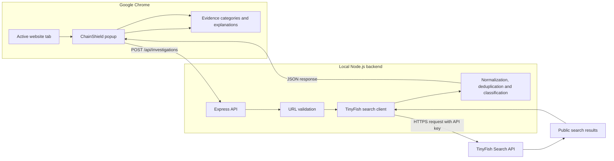
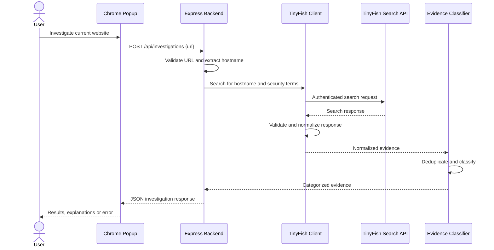
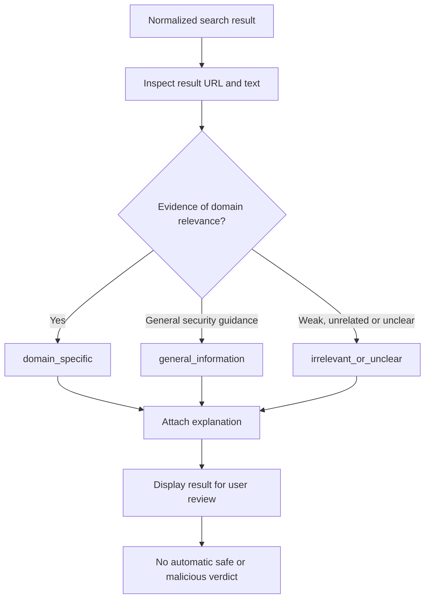

# ChainShield 🛡️

**Evidence-based website and Web3 threat intelligence, directly from your Chrome toolbar.**

ChainShield is a Chrome Extension (Manifest V3) connected to a local Node.js and Express backend. It investigates a user-selected website by searching for publicly available information through the TinyFish Search API, then organizes the returned sources into understandable evidence categories.

Instead of making unsupported claims about whether a website is safe or malicious, ChainShield helps users examine relevant public information, understand why a source was included, and investigate further.

> **Core principle:** Evidence is not a verdict. A relevant search result does not prove malicious activity, and the absence of evidence does not mean a website is safe.

---

## Contents

1. [The problem](#the-problem)
2. [How ChainShield works](#how-chainshield-works)
3. [Architecture](#architecture)
4. [Technology stack](#technology-stack)
5. [Quick start](#quick-start)
6. [Configuration](#configuration)
7. [API reference](#api-reference)
8. [Evidence classification](#evidence-classification)
9. [Project structure](#project-structure)
10. [Testing](#testing)
11. [Security and privacy](#security-and-privacy)
12. [Troubleshooting](#troubleshooting)
13. [Current limitations](#current-limitations)
14. [Future scope](#future-scope)

---

## The problem

Websites associated with phishing, impersonation, scams, and fraud can be difficult to evaluate. Users may encounter unfamiliar domains, misleading search results, or security claims without knowing which sources are relevant.

| Challenge | Why it matters |
|---|---|
| Fragmented information | Relevant reports and discussions may be scattered across public websites. |
| Misleading search results | A search result mentioning a security topic may have nothing to do with the investigated domain. |
| Unsupported verdicts | A website should not be labelled malicious merely because its name appears in a search result. |
| Difficult investigation workflows | Users often need to open multiple tabs and manually compare sources. |

ChainShield provides a small, accessible starting point: investigate the current website, review publicly available search results, and see why each result was categorized.

## How ChainShield works

### User flow

1. Open a regular website using Google Chrome.
2. Open the ChainShield extension from the Chrome toolbar.
3. Select **Investigate this website**.
4. The extension reads the current tab's URL and sends it to the local backend.
5. The backend validates the URL and extracts its hostname.
6. The backend builds a focused search query containing the hostname and security-related terms.
7. TinyFish Search returns public search results.
8. ChainShield normalizes, deduplicates, and classifies the returned evidence.
9. The extension displays grouped results and explanations to help the user assess their relevance.

### Investigation flow



The flow describes the intended investigation process. A successful HTTP response alone does not guarantee that a live search succeeded; the API status and returned investigation details must also be checked.

---

## Architecture

### System architecture



### Component responsibilities

| Component | Responsibility |
|---|---|
| Chrome extension | Reads the active tab after the user initiates an investigation and displays the results. |
| Express API | Accepts investigation requests, validates input, and returns structured JSON. |
| TinyFish integration | Builds a focused search query and requests public search results. |
| Classification module | Normalizes evidence, removes duplicate results conservatively, and assigns categories with explanations. |
| Test suite | Checks API behavior, classification rules, validation, and mocked upstream responses. |

### Request and response sequence



If validation fails, the upstream service fails, or the response is malformed, the backend should return an appropriate error rather than inventing evidence.

---

## Technology stack

| Layer | Technology | Purpose |
|---|---|---|
| Browser extension | Chrome Extension Manifest V3 | Extension permissions and popup integration |
| Frontend | HTML, CSS, JavaScript | Popup interface and evidence presentation |
| Backend | Node.js, Express | HTTP API and investigation orchestration |
| Search | TinyFish Search API | Retrieves public search results |
| Configuration | dotenv | Loads the backend API key from a local environment file |
| Testing | Node.js test runner and mocked responses | Tests backend and classification behavior |
| Version control | Git and GitHub | Source code and change history |

ChainShield currently does not require a database, a frontend framework, or an AI model for its core investigation flow.

---

## Quick start

### Requirements

- Google Chrome
- Node.js 18 or newer
- npm
- A TinyFish API key

### 1. Clone the repository

```powershell
git clone https://github.com/iamjahnvi/ChainShield.git
cd ChainShield
```

### 2. Install backend dependencies

```powershell
cd server
npm install
```

### 3. Configure the API key

Create a local environment file from the provided example:

```powershell
Copy-Item .env.example .env
```

Open `server/.env` and add your own provider keys:

```dotenv
TINYFISH_API_KEY=your_tinyfish_api_key
GOOGLE_SAFE_BROWSING_API_KEY=your_google_safe_browsing_api_key
```

Replace the placeholders with your own keys. Never commit this file or share its contents. Restrict the Google key to the Safe Browsing API in Google Cloud.

### 4. Run the tests

From the `server` directory:

```powershell
npm test
```

Tests should complete successfully before you begin manual verification. The tests use mocked search responses where configured, so they should not require a live TinyFish request.

### 5. Start the backend

```powershell
npm start
```

The backend listens on:

```text
http://localhost:3000
```

Keep this terminal open while using the extension.

### 6. Verify the backend

Open another PowerShell terminal and run:

```powershell
Invoke-RestMethod http://localhost:3000/api/health
```

Expected health response:

```json
{
  "status": "ok"
}
```

This confirms that the server is responding. It does not by itself confirm that TinyFish is configured or that a live investigation works.

### 7. Load the extension in Chrome

1. Open `chrome://extensions`.
2. Enable **Developer mode**.
3. Click **Load unpacked**.
4. Select the repository's `extension` folder.
5. Open a regular `http://` or `https://` website.
6. Open ChainShield from the Extensions menu.
7. Click **Investigate this website**.

After changing extension files, return to `chrome://extensions`, click **Reload** on ChainShield, and reopen the popup.

---

## Configuration

| Setting | Location | Purpose |
|---|---|---|
| `TINYFISH_API_KEY` | `server/.env` | Authenticates requests from the backend to TinyFish |
| `GOOGLE_SAFE_BROWSING_API_KEY` | `server/.env` | Authenticates backend URL lookups with Google Safe Browsing |
| `PORT` | Backend environment | Optional server port; defaults to `3000` |

The extension currently expects the API at `http://localhost:3000`. If you change the backend port, update the API URL in `extension/popup.js` to match.

The Google Safe Browsing integration is for non-commercial development use. Google directs commercial users to Web Risk. The submitted URL is sent to Google for lookup. Positive matches are cached in memory only for the provider's returned cache duration; no lookup history is persisted. Do not put either provider key in the extension's JavaScript, HTML, manifest, or any response sent to the browser.

---

## API reference

### `GET /api/health`

Checks whether the Express server is responding.

Example:

```powershell
Invoke-RestMethod http://localhost:3000/api/health
```

Successful response:

```json
{
  "status": "ok"
}
```

### `POST /api/investigations`

Starts a website investigation using the supplied URL.

**Request**

```http
POST /api/investigations
Content-Type: application/json
```

```json
{
  "url": "https://example.com"
}
```

PowerShell example:

```powershell
Invoke-RestMethod `
  -Uri http://localhost:3000/api/investigations `
  -Method POST `
  -ContentType "application/json" `
  -Body '{"url":"https://example.com"}'
```

This command makes a live investigation request and may consume TinyFish API quota.

**Successful response shape**

The following is an illustrative example of the response structure, not a claim about the current live search results:

```json
{
  "status": "research_available",
  "summary": "Search sources are available for review. Their relevance does not prove malicious activity.",
  "domain": "example.com",
  "evidence": [
    {
      "title": "Example source",
      "url": "https://source.example/report",
      "snippet": "Example search-result excerpt",
      "source": "TinyFish Search",
      "category": "domain_specific",
      "categoryReason": "The source URL is related to the investigated hostname. Relevance does not establish maliciousness."
    }
  ],
  "investigationType": "web_search",
  "demo": false,
  "threatAssessment": {
    "status": "no_match",
    "providers": [
      {
        "id": "google_safe_browsing",
        "name": "Google Safe Browsing",
        "status": "no_match",
        "scope": "submitted_url",
        "matches": []
      }
    ]
  }
}
```

The actual evidence, summary, and status depend on the backend implementation and upstream search response.

`threatAssessment` is separate from TinyFish evidence and may have `reported`, `no_match`, `incomplete`, or `unavailable` status. A `no_match` means only that Google Safe Browsing returned no match for the submitted URL; it is not a safety verdict. An unavailable provider is never represented as a clean result.

Google requires qualifying language for reported threats, a linked “Advisory provided by Google” attribution, and notice that results can include false positives and false negatives. The popup displays these notices. Review the current [Safe Browsing usage requirements](https://developers.google.com/safe-browsing/v4/usage-limits) before using this integration beyond non-commercial development.

### Response fields

| Field | Description |
|---|---|
| `status` | Indicates whether research sources were returned or no results were found. |
| `summary` | Explains the search outcome without claiming a security verdict. |
| `domain` | Hostname extracted from the submitted URL. |
| `evidence` | List of normalized search results and their classifications. |
| `investigationType` | Identifies the investigation as a web search. |
| `demo` | Indicates whether the response is a demo response. |
| `threatAssessment` | Separate Google Safe Browsing lookup result; it does not use TinyFish relevance as a threat score. |

Evidence items may contain `title`, `url`, `snippet`, `source`, `position`, `siteName`, `category`, and `categoryReason`, depending on the available upstream data and normalization.

Error responses use a JSON `error` field. Malformed upstream results and upstream failures should not be silently presented as a successful empty investigation.

---

## Evidence classification

ChainShield groups search results into three categories.

| Category | Meaning |
|---|---|
| `domain_specific` | The result URL or relevant text is associated with the investigated hostname. This is a relevance signal, not proof of a threat. |
| `general_information` | General security guidance that is not specifically about the investigated hostname. |
| `irrelevant_or_unclear` | Results that are weakly related, unclear, or unrelated to the investigation. |

Each classified item can include a `categoryReason` explaining why it was assigned that category.

### Why classification matters

A search engine can return generic phishing guides, broad security articles, or unrelated pages even when the search query contains a particular domain.

ChainShield attempts to separate domain-related evidence from general information and weak matches, so the user can prioritize what to inspect.



The classification is heuristic. A domain-related result can still be harmless, inaccurate, or misleading. The classification is not a substitute for independent verification.

If no domain-specific evidence is found, ChainShield should explain that limitation clearly. It must not infer that the website is safe.

---

## Project structure

```text
ChainShield/
├── extension/
│   ├── manifest.json
│   ├── popup.html
│   ├── popup.css
│   └── popup.js
│
├── server/
│   ├── src/
│   │   ├── app.js
│   │   ├── tinyfish.js
│   │   ├── safe-browsing.js
│   │   ├── classification.js
│   │   └── routes/
│   │       └── investigations.js
│   │
│   ├── test/
│   │   ├── app.test.js
│   │   ├── investigations.test.js
│   │   └── classification.test.js
│   │
│   ├── .env.example
│   ├── package.json
│   └── package-lock.json
│
├── .gitignore
└── README.md
```

### Important files

| File | Responsibility |
|---|---|
| `extension/manifest.json` | Declares the extension configuration and permissions. |
| `extension/popup.html` | Defines the popup interface. |
| `extension/popup.css` | Controls popup styling, layout, and interaction states. |
| `extension/popup.js` | Reads the active tab, calls the backend, and renders investigation results. |
| `server/src/app.js` | Configures Express, middleware, health checks, and server startup. |
| `server/src/tinyfish.js` | Builds the search query, calls TinyFish, and normalizes upstream responses. |
| `server/src/safe-browsing.js` | Performs a timed, backend-only Google Safe Browsing URL lookup. |
| `server/src/classification.js` | Deduplicates evidence and assigns categories with explanations. |
| `server/src/routes/investigations.js` | Validates investigation requests and constructs API responses. |
| `server/test/app.test.js` | Tests the health endpoint and request validation. |
| `server/test/investigations.test.js` | Tests investigation behavior with mocked upstream responses. |
| `server/test/classification.test.js` | Tests classification, URL handling, and deduplication. |

---

## Testing

Run the automated backend test suite from the `server` directory:

```powershell
npm test
```

The test suite should cover:

- Health endpoint behavior.
- Invalid investigation URLs.
- Search query construction.
- Normalized search results.
- Domain and subdomain relevance.
- Conservative URL deduplication.
- Empty and malformed upstream responses.
- Upstream failures and safe error handling.
- Google Safe Browsing matches, no-match results, configuration errors, timeouts, and malformed responses.
- Evidence categories and explanations.

Mocked tests do not verify live provider availability, API-key validity, or Google Cloud API restrictions.

### Manual verification checklist

- [ ] The backend health endpoint returns `status: ok`.
- [ ] The extension loads in Chrome without a manifest error.
- [ ] An investigation sends the active website URL to the backend.
- [ ] Search results appear under the appropriate categories.
- [ ] Classification explanations appear where available.
- [ ] Source links open only when clicked.
- [ ] No-results responses do not imply that a site is safe.
- [ ] API failures are displayed as errors, not as successful empty investigations.
- [ ] Chrome internal pages such as `chrome://settings` are rejected as unsupported.
- [ ] No API key appears in the extension or API responses.
- [ ] A Google match is shown separately from web-search relevance and includes Google's advisory attribution.
- [ ] No match and unavailable checks are not described as safe.

---

## Security and privacy

ChainShield follows a conservative, evidence-first approach.

- **Backend-held API keys:** TinyFish and Google Safe Browsing keys are stored in `server/.env` and used only by backend clients.
- **No key in the extension:** The extension must never receive the API key.
- **Provider separation:** Google threat matches are distinct from TinyFish search relevance.
- **Limited lookup:** Google Safe Browsing checks only the submitted URL; an unavailable or no-match response does not establish safety.
- **Input validation:** Investigation URLs are validated before searching.
- **Safe source rendering:** Titles, snippets, and explanations should be rendered as text rather than trusted HTML.
- **Explicit user action:** The user initiates an investigation from the popup.
- **No automatic blocking:** ChainShield does not automatically block websites.
- **No unsupported verdicts:** Search evidence is not treated as a definitive security determination.
- **No-results caution:** The absence of search evidence is not evidence that a website is safe.

The current prototype uses a local backend and is not production deployment guidance. A public deployment would require additional security controls, including authentication or abuse protection, rate limiting, stricter origin policies, and secure secret management.

---

## Troubleshooting

| Problem | What to check |
|---|---|
| `EADDRINUSE` on port `3000` | Another process is already using the port. Identify it before terminating anything. |
| `npm start` says `package.json` cannot be found | Run the command from the `server` directory, not the repository root. |
| Health endpoint works but investigation returns a demo response | Inspect the running process and confirm that it is using the intended ChainShield checkout and current source code. |
| Extension says the response is missing expected details | Compare the actual `/api/investigations` JSON with the response structure expected by `extension/popup.js`. |
| TinyFish configuration error | Check that `server/.env` exists and defines `TINYFISH_API_KEY`. Never paste the key into logs or public issues. |
| Investigation returns no results | Confirm the API response status and inspect whether the upstream search returned a valid empty result list. No results does not mean safe. |
| Investigation returns an upstream error | Check backend logs and TinyFish service/API configuration without exposing credentials. |
| Changes do not appear in Chrome | Reload the extension at `chrome://extensions`, then close and reopen the popup. |
| `npm test` fails because a dependency is missing | Run `npm install` from `server`, then rerun `npm test`. |

### Identify the process using port 3000 on Windows

```powershell
netstat -ano | findstr :3000
```

Read the PID from the `LISTENING` line, then inspect it using the actual PID:

```powershell
Get-CimInstance Win32_Process -Filter "ProcessId = 13528" |
  Select-Object ProcessId, ExecutablePath, CommandLine
```

Replace `13528` with the PID shown on your machine. Inspect the process before stopping it.

---

## Current limitations

- Search results depend on the upstream TinyFish Search API response.
- The system does not perform a full malware scan, phishing-page analysis, smart-contract audit, or on-chain investigation.
- Classification is heuristic and can make mistakes.
- Search-result excerpts are not independently verified facts.
- No search results do not establish safety.
- The current extension is designed around a local backend.
- Automated backend tests do not replace manual browser verification.

---

## Future scope

Potential improvements, subject to validation and testing:

- Add more trustworthy public threat-intelligence sources.
- Improve evidence ranking and explainability.
- Introduce source freshness and provenance indicators.
- Add caching and rate limiting for repeated investigations.
- Improve tests for malformed upstream responses and browser-extension integration.
- Explore Web3-specific intelligence sources, such as public phishing reports and contract metadata, with clearly defined validation rules.
- Add optional user-controlled investigation history if a persistence layer is justified.

Future work should preserve ChainShield's core principle: report what the evidence supports, explain uncertainty, and never present missing evidence as proof of safety.

---

## License

Check the repository's license before redistributing or reusing the project.

---

**ChainShield — investigate the evidence, not just the claim.**
